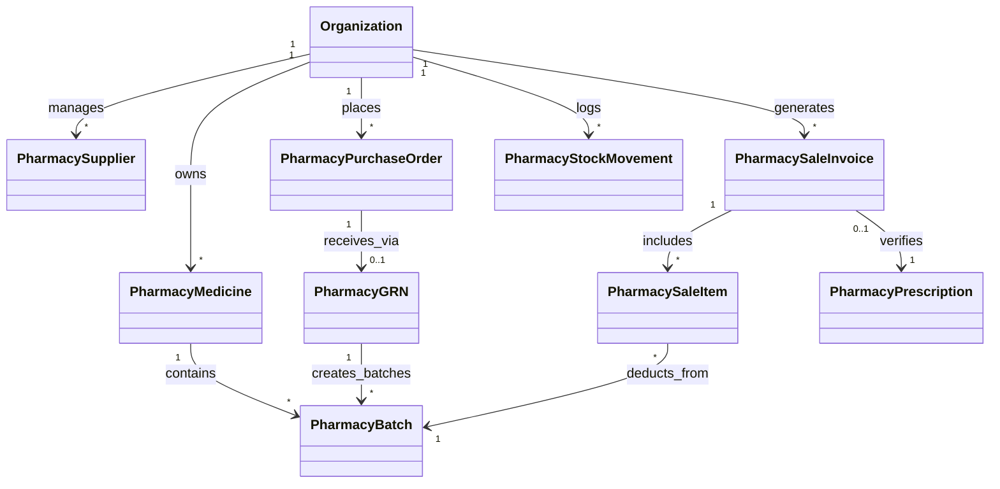
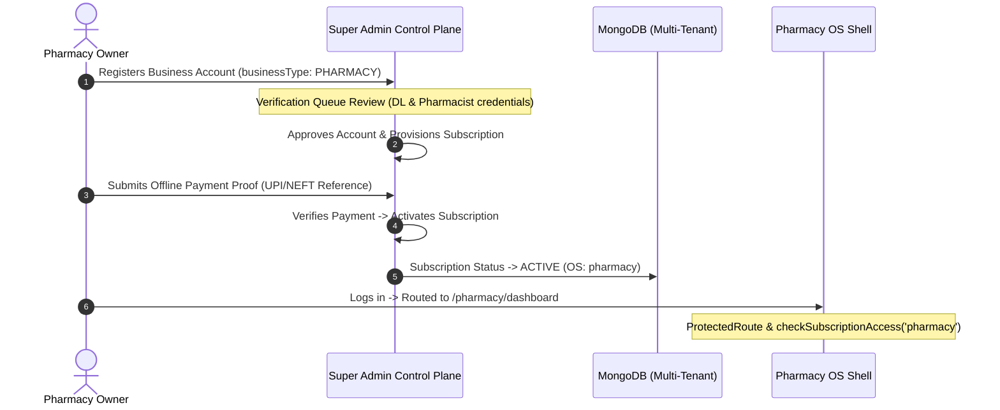

# ApexBuild Pharmacy OS — Technical Architecture & System Design

> **Document Version:** 1.0.0  
> **Status:** Architecture Blueprint  
> **Target System:** ApexBuild Pharmacy OS (Vertical 6)  
> **Ecosystem:** ApexBuild Multi-Tenant Control Plane  

---

## 1. Architectural Principles & Platform Conformance

ApexBuild Pharmacy OS strictly conforms to the established ApexBuild Multi-Tenant Operating System architecture. Rather than introducing independent sub-frameworks, disparate styling libraries, or non-standard database access layers, Pharmacy OS leverages:
1. **Centralized Super Admin Control Plane:** Commercial subscriptions, plan tiers, entitlement enforcement, and tenant provisioning remain managed exclusively by Super Admin.
2. **Unified Front-End Shell:** Standardized header, dynamic brand theming, responsive sidebar, bottom mobile bar, masquerading support, and PWA integration.
3. **Strict Tenant Scoping:** All MongoDB collections and database queries are strictly partitioned by `organizationId`. Cross-tenant data leaks are physically blocked at the database level.
4. **Decoupled Backend Boundaries:** Pharmacy domain services operate in dedicated routers and controllers without contaminating Contractor, Supplier, Distributor, Diagnostics, or Restaurant modules.
5. **FEFO & Batch Integrity:** First-Expiry, First-Out allocation engine ensures clinical safety and zero sale of expired medicines.

---

## 2. Platform Component Reusability Matrix

The following existing platform assets are verified in the codebase and reused directly by Pharmacy OS:

| Existing Platform Component / Service | Location | How Pharmacy OS Leverages It |
| :--- | :--- | :--- |
| `ThemeContext` & `useBrandTheme()` | `frontend/src/context/ThemeContext.jsx` | Dynamic color injection, CSS custom properties (`--theme-primary`, `--theme-secondary`), medical teal palette (`#0D9488`). |
| `OS_CONFIG` & `getOSConfig()` | `frontend/src/config/osThemes.js` | Centralized metadata, color schemes (medical teal & emerald), shortCode `RX`, roleTag `PHARMACY`, and route matching. |
| `SidebarUserProfile` | `frontend/src/components/layout/SidebarUserProfile.jsx` | Unified bottom profile card with plan badge, upgrade modal triggers, and logout confirmation. |
| `Header` | `frontend/src/components/layout/Header.jsx` | Unified header with search bar, notifications, tenant isolation status badge, and profile modal. |
| `LogoutConfirmationModal` | `frontend/src/components/common/LogoutConfirmationModal.jsx` | Standardized secure session termination dialog. |
| `PWAInstallBanner` & `OfflineStatusBanner` | `frontend/src/components/common/` | Touch-screen tablet and mobile installation prompts, connection loss indicator. |
| `MasqueradeBar` | `frontend/src/components/layout/MasqueradeBar.jsx` | Allows Super Admin to inspect a pharmacy workspace without stealing session tokens. |
| `EntitlementContext` & `FeatureGate` | `frontend/src/context/EntitlementContext.jsx` | Gate advanced pharmacy capabilities (e.g., Schedule H1 registry, multi-rack batch tracking) based on plan tier. |
| `PlatformBilling` | `frontend/src/pages/PlatformBilling.jsx` | Reused for viewing OS subscriptions, invoices, and submitting offline UPI/bank payment receipts. |
| `api.js` (Axios Interceptors) | `frontend/src/services/api.js` | Universal JWT attachment, 401 unauthenticated redirect, and error propagation. |

---

## 3. Frontend Architecture & Routing Structure

### Route Map
```text
/pharmacy
├── /dashboard              -> PharmacyDashboard.jsx (Daily operational KPIs, live sales, near-expiry alerts, stockouts)
├── /pos                    -> PharmacyPOS.jsx (High-speed counter POS, FEFO batch selection, Rx capture, thermal bill)
├── /medicines              -> PharmacyMedicines.jsx (Medicine catalogue, generic salts, strengths, schedule categories)
├── /inventory              -> PharmacyInventory.jsx (Batch-level stock ledger, rack locations, quantities, valuations)
├── /expiry                 -> PharmacyExpiry.jsx (Dedicated expiry quarantine, near-expiry triage, supplier debit notes)
├── /purchases              -> (Roadmap Phase 2: Suppliers directory, POs, Goods Receipt Notes / GRN)
├── /suppliers              -> (Roadmap Phase 2: Authorized distributors, licence credentials, payables)
├── /sales                  -> (Roadmap Phase 3: Sales history, invoice reprints, audit logs)
├── /returns                -> (Roadmap Phase 3: Customer sales returns, batch verification, quarantine checks)
├── /adjustments            -> (Roadmap Phase 4: Stock reconciliation discrepancies, breakage logs)
├── /customers              -> (Roadmap Phase 5: Patient profiles, chronic medication khata, allergy records)
├── /expenses               -> (Roadmap Phase 6: Pharmacy overheads, refrigeration power, staff salaries)
├── /reports                -> (Roadmap Phase 7: Schedule H/H1 registers, GST tax reports, gross profit P&L)
├── /staff                  -> (Roadmap Phase 8: Pharmacist licences, counter clerks, shift handovers)
├── /settings               -> Settings.jsx (Pharmacy profile, DL 20B/21B, FSSAI, GSTIN, receipt layout)
├── /subscription           -> PlatformBilling.jsx (Pharmacy OS subscription tier, invoices & payments)
└── /profile                -> Profile.jsx (User profile, password update)
```

### Layout Hierarchy
```text
<AuthProvider>
  <EntitlementProvider>
    <ThemeProvider>
      <ProtectedRoute allowedBusinessTypes={['PHARMACY']}>
        <PharmacyLayout>
          ├── <Header />
          ├── Desktop Sidebar (64-width with medical teal accents & navigation items)
          ├── Mobile Bottom Navigation (Dashboard, POS, Medicines, Inventory & 'More' Drawer)
          ├── Floating Action Button (Quick New Sale / Quick Medicine Lookup on mobile)
          └── <Outlet /> (Active Pharmacy Screen)
        </PharmacyLayout>
      </ProtectedRoute>
    </ThemeProvider>
  </EntitlementProvider>
</AuthProvider>
```

---

## 4. Backend Service Boundaries & Proposed Data Models

### Mongoose Data Model Blueprint (Backend Implementation Scope)


#### Core Data Entities:
1. **`PharmacyMedicine`**: `name`, `genericName`, `strength`, `dosageForm`, `packSize`, `unitConversionFactor`, `manufacturer`, `hsnCode`, `gstRate`, `scheduleCategory` (`OTC`, `SCHEDULE_H`, `SCHEDULE_H1`, `SCHEDULE_X`, `SCHEDULE_G`), `reorderLevel`, `storageCondition`, `isDiscontinued`.
2. **`PharmacyBatch`**: `medicineId`, `batchNumber`, `manufacturer`, `mfgDate`, `expiryDate`, `purchasePrice`, `mrp`, `sellingPrice`, `quantityOnHand`, `quarantineQuantity`, `rackLocation`, `status` (`SALEABLE`, `NEAR_EXPIRY`, `EXPIRED`, `QUARANTINED`, `RETURNED_TO_SUPPLIER`).
3. **`PharmacySupplier`**: `name`, `dlNumber`, `gstin`, `phone`, `email`, `address`, `paymentTermsDays`, `outstandingBalance`.
4. **`PharmacyPurchaseOrder`**: `poNumber`, `supplierId`, `status` (`DRAFT`, `ORDERED`, `PARTIALLY_RECEIVED`, `COMPLETED`, `CANCELLED`), `items: [{ medicineId, quantity, expectedRate }]`, `totalAmount`.
5. **`PharmacyGRN`**: `grnNumber`, `poId`, `supplierInvoiceNumber`, `supplierInvoiceDate`, `items: [{ medicineId, batchNumber, mfgDate, expiryDate, quantityReceived, freeQuantity, purchaseRate, tradeDiscount, mrp, gstRate }]`, `verifiedByPharmacistId`.
6. **`PharmacySaleInvoice`**: `invoiceNumber`, `customerName`, `customerPhone`, `prescriptionId`, `subTotal`, `discountAmount`, `cgstAmount`, `sgstAmount`, `roundOff`, `grandTotal`, `paymentMethod` (`CASH`, `UPI`, `CARD`, `CREDIT`, `SPLIT`), `pharmacistId`, `status` (`COMPLETED`, `REFUNDED`, `CANCELLED`).
7. **`PharmacySaleItem`**: `invoiceId`, `medicineId`, `batchId`, `quantityPacks`, `quantityStrips`, `unitPrice`, `taxRate`, `cgst`, `sgst`, `totalPrice`.
8. **`PharmacyPrescription`**: `doctorName`, `doctorRegNumber`, `clinicName`, `patientName`, `patientAge`, `patientGender`, `prescriptionDate`, `documentUrl`, `verifiedByPharmacistId`, `scheduleH1Dispensed`.
9. **`PharmacyStockMovement`**: `medicineId`, `batchId`, `movementType` (`PURCHASE_INWARD`, `SALE_DEDUCTION`, `SALE_RETURN`, `SUPPLIER_RETURN`, `QUARANTINE_HOLD`, `BREAKAGE_ADJUSTMENT`), `quantityDelta`, `referenceDocNumber`, `performedBy`.

---

## 5. Super Admin Integration Architecture

To maintain platform cohesion, Pharmacy OS integrates seamlessly with Super Admin:



### Feature Entitlement Definitions for Pharmacy OS Plans:
- **`medicineCatalog`**: Medicine & generic salt drug master catalog.
- **`batchInventory`**: Batch-level inventory tracking and shelf rack allocation.
- **`posBilling`**: High-speed counter POS, FEFO selection, and thermal tax invoices.
- **`expiryControl`**: Multi-window near-expiry alerts (30/60/90 days) and quarantine isolation.
- **`prescriptionValidation`**: Mandatory doctor reg and patient capture for Rx drugs.
- **`supplierPurchases`**: Purchase orders, goods receipt notes (GRN), and batch inward.
- **`salesReturns`**: Controlled returns with original bill and batch verification.
- **`scheduleHCompliance`**: Tamper-proof Schedule H and H1 statutory dispensing register.
- **`customBranding`**: Custom pharmacy header, logo, and DL details on printed bills.

---

## 6. Security, Isolation & Safety Controls

1. **Authentication & Token Payload:** JWT standard carries `id` and `organizationId`. Every database operation is scoped by `req.user.organizationId`.
2. **Access Redirection:** If a user with `businessType: 'CONTRACTOR'` attempts to navigate to `/pharmacy/dashboard`, `ProtectedRoute` intercepts and redirects them back to their assigned OS dashboard.
3. **No Cross-Pollination:** Pharmacy OS routes and components never import or mutate Contractor, Supplier, Distributor, Diagnostics, or Restaurant controllers or models.
4. **Backend Expiry Block:** The checkout endpoint revalidates all batch expiry dates on the server at execution time. Even if client-side validation is bypassed, expired batches are physically rejected from sale.
