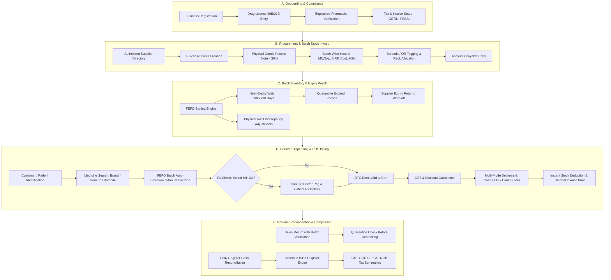

# ApexBuild Pharmacy OS — Complete Business Process Specification

> **Document Version:** 1.0.0  
> **Status:** Approved Architecture & Process Specification  
> **Target System:** ApexBuild Pharmacy OS (Vertical 6)  
> **Ecosystem:** ApexBuild Multi-Tenant Control Plane  
> **Applicable Jurisdiction:** India (Drugs and Cosmetics Act, 1940 & Rules 1945, Pharmacy Act 1948, Central Goods and Services Tax Act 2017)

---

## 1. Executive Summary & Domain Context

**ApexBuild Pharmacy OS** is a specialized, multi-tenant retail pharmacy operating system designed specifically for independent community pharmacies, retail chemist shops, pharmacy chains, and outpatient dispensary counters.

Unlike standard retail point-of-sale software, retail pharmacy operations in India are governed by stringent statutory regulations:
1. **Drug Licences (Form 20B & 21B):** Retail sales of allopathic drugs require valid State Drug Controller licences.
2. **Mandatory Registered Pharmacist Supervision:** Under Section 42 of the Pharmacy Act, 1948, dispensing of prescription drugs must be carried out by or under the direct supervision of a Registered Pharmacist registered with the State Pharmacy Council.
3. **Scheduled Drug Regimes:**
   - **Schedule H & H1:** Prescription drugs requiring physician prescription, patient details, and a dedicated dispensing register (with Schedule H1 requiring 3-year record retention including prescriber name, patient name, drug name, batch number, and quantity).
   - **Schedule X:** Psychotropic and habit-forming drugs requiring triplicate prescription records, strict custody, and reporting.
   - **OTC (Over-The-Counter):** Non-scheduled items, health supplements, nutraceuticals, surgicals, and toiletries.
4. **Batch-Level Traceability & Expiry Management:** Every unit in stock must maintain unbroken lineage to an authorized manufacturer/distributor batch, manufacturing date, and expiry date. Selling expired medicine is a criminal offence under Indian law.
5. **FEFO (First-Expiry, First-Out) Logistics:** Inventory must be dispensed primarily based on earliest expiry date to minimize dead stock and clinical hazards.
6. **Pack Size & Strip Splitting (Unit Conversion):** Wholesalers invoice in boxes or outer cartons, while retailers sell in individual blisters/strips or even loose tablets, requiring fractional unit conversion without creating fractional inventory leaks.

---

## 2. End-to-End Pharmacy Operational Lifecycle

---

## 3. Detailed Operational Modules

### A. Business Onboarding & Statutory Configuration

1. **Entity Verification:**
   - Registration via the ApexBuild onboarding portal specifying Business Name, Trade Name, Registered Address, PAN, GSTIN, and State.
   - Initial approval workflow through Super Admin `VERIFICATION_QUEUE`.
2. **Pharmacy Statutory Credentials:**
   - **Retail Drug Licence Numbers:** Form 20 (General Drugs), Form 21 (Biological/Special), Form 20B/21B for wholesale/retail combined where applicable.
   - **Licence Validity Period:** Issue Date and Expiry Date with automatic 60-day renewal notification alerts.
   - **Registered Pharmacist In-Charge (PIC):**
     - Pharmacist Full Name.
     - State Pharmacy Council Registration Number (e.g., `WB-48291`).
     - Registration Validity Date.
     - Degree / Diploma Certificate upload for audit records.
   - **FSSAI Licence Number:** Mandatory for selling nutraceuticals, baby food, infant milk substitutes, and dietary supplements.
3. **Store & Invoicing Configuration:**
   - Thermal receipt header/footer settings.
   - Operating hours and shift schedules.
   - Default GST tax groups (0%, 5%, 12%, 18%).
   - Near-expiry notification thresholds (Default: 90 days, 60 days, 30 days).

---

### B. Daily Operations & Control Center Dashboard

1. **Shift Initialization:**
   - Cashier or Pharmacist logs in and enters opening register cash float.
   - System confirms active Pharmacist In-Charge on duty before unlocking prescription dispensing.
2. **Real-Time Operational KPIs:**
   - **Today's Gross Sales & Net Collections:** Cash, UPI dynamic QR, Cards, Credit (Khata).
   - **Counter Transaction Count:** Total bills generated, average bill value.
   - **Inventory Valuation:** Total inventory value computed at Purchase Cost vs. Total Value at MRP.
   - **Near-Expiry Warning Widget:** Batches expiring within 30, 60, and 90 days.
   - **Expired / Blocked Batches:** Items requiring immediate quarantine to prevent accidental dispensing.
   - **Critical Stockouts & Reorder Triggers:** Fast-moving drugs below reorder safety stock.
   - **Schedule H1 Dispensing Count:** Number of regulated prescriptions dispensed today.
   - **Pending Supplier Payables:** Outstanding credit bills due within 7 days.

---

### C. Medicine Catalogue Master-Data Management

1. **Medicine Master Attributes:**
   - **Brand Name:** e.g., *Augmentin 625 Duo*, *Pan D*, *Telma 40*.
   - **Generic / Active Pharmaceutical Ingredient (API):** e.g., *Amoxicillin (500mg) + Clavulanic Acid (125mg)*.
   - **Dosage Form:** Tablet, Capsule, Syrup, Suspension, Injection, Ointment, Gel, Drops, Inhaler, Respule, Powder.
   - **Strength:** e.g., *625mg*, *500mg*, *40mg*, *100ml*.
   - **Manufacturer / Marketing Company:** e.g., *GlaxoSmithKline*, *Alkem Laboratories*, *Cipla*, *Sun Pharma*.
   - **Schedule Classification:**
     - `OTC`: Over The Counter (no prescription required).
     - `SCHEDULE_H`: Prescription required; dispensing entry mandatory.
     - `SCHEDULE_H1`: Strict antibiotic / psychotropic; doctor reg and patient records preserved for 3 years.
     - `SCHEDULE_X`: Habit-forming narcotic; special locking and triplicate reporting.
     - `SCHEDULE_G`: Warning label required ("It is dangerous to take this preparation except under medical supervision").
   - **Pack Architecture & Unit Conversion:**
     - Outer Purchase Pack (e.g., Box of 10 Strips).
     - Inner Sale Unit (e.g., 1 Strip containing 10 Tablets).
     - Minimum Dispensing Unit (Strip vs. Loose Tablet fraction).
     - Unit Conversion Factor (e.g., 1 Box = 10 Strips = 100 Tablets).
   - **Tax & Classification Codes:**
     - HSN Code (Harmonized System of Nomenclature, e.g., `3004` for medicaments).
     - GST Slab: `0%` (Insulin, Contraceptives), `5%` (Life-saving vaccines), `12%` (Most standard allopathic formulations), `18%` (Nutraceuticals, Disinfectants, Shampoos).
   - **Storage Requirements:**
     - Room Temperature (`15°C – 25°C`).
     - Cold Chain Refrigerated (`2°C – 8°C`, e.g., Vaccines, Insulin, Monoclonal Antibodies).
     - Cool & Dry Place (`below 25°C`, protected from moisture and direct sunlight).
   - **Rack & Shelf Location:** e.g., `Rack A-02`, `Fridge F-01`, `Drawers D-05`.

---

### D. Supplier Management & Procurement (Procure-to-Stock)

1. **Supplier Master:**
   - Authorized Pharmaceutical Distributor Name, Wholesale Drug Licence Number (Form 20B/21B).
   - GSTIN, PAN, Registered Address, Contact Person, Phone, Email.
   - Payment terms (e.g., 15 Days Credit, 30 Days Credit, Immediate Cash).
2. **Purchase Workflow:**
   $$\text{Supplier PO} \longrightarrow \text{Physical Delivery} \longrightarrow \text{Goods Received Note (GRN)} \longrightarrow \text{Batch Ledger Inward} \longrightarrow \text{Supplier Invoicing}$$
3. **Goods Received Note (GRN) Verification:**
   - Check supplier invoice number and date against received cartons.
   - Verify physical batch number, mfg date, and expiry date printed on blisters/boxes against supplier invoice.
   - Verify Maximum Retail Price (MRP) printed on packaging.
   - Record short delivery, damaged ampoules, or missing packs at the inward bay.
   - Capture Purchase Rate, Trade Discount (%), Scheme Discount (e.g., 10 + 1 free), GST, and Net Cost.
   - Prevent duplicate invoice numbers per supplier to eliminate phantom inventory duplication.
4. **Stock Increment Guarantee:** Stock ledger increases **only** upon authorized GRN approval with verified batch lines. Draft POs have zero impact on physical stock.

---

### E. Batch-Level Inventory Management

1. **Batch Ledger Record Schema:**
   Every physical stock holding represents an immutable batch line:
   - `medicineId`: Reference to Medicine Master.
   - `batchNumber`: Unique manufacturer batch string (e.g., `AUG24018`).
   - `manufacturer`: Verified drug manufacturer.
   - `mfgDate`: Manufacturing month/year (e.g., `03/2024`).
   - `expiryDate`: Expiry month/year (e.g., `02/2026`).
   - `purchasePrice`: Cost of purchase per unit excluding input tax credit.
   - `mrp`: Maximum Retail Price printed on the pack (inclusive of all taxes).
   - `sellingPrice`: Actual counter selling price ($\le \text{MRP}$). Selling above MRP is strictly illegal.
   - `quantityOnHand`: Total available units in saleable stock.
   - `quarantineQuantity`: Stock held in quarantine due to expiry, recall, or damage.
   - `storageLocation`: Rack, Shelf, Bin, or Refrigerator tag.
2. **Traceable Stock Movements:**
   Every quantity delta must be recorded in an immutable ledger with:
   - Event Type (`PURCHASE_RECEIPT`, `SALE_DISPENSE`, `SALE_RETURN`, `SUPPLIER_RETURN`, `STOCK_ADJUSTMENT`, `EXPIRED_QUARANTINE`, `BREAKAGE_WRITE_OFF`).
   - Reference document ID (Invoice #, Bill #, Credit Note #).
   - User ID and timestamp.

---

### F. Expiry & Near-Expiry Management

1. **Expiry Alert Windows:**
   - **Critical (0 – 30 Days):** High priority alert; remove from main sales shelf or flag with instant warning.
   - **Near Expiry (31 – 60 Days):** Prioritize in FEFO dispatch; verify supplier return agreement window.
   - **Watchlist (61 – 90 Days):** Standard warning list for slow-moving stock liquidation.
2. **Backend Sale Prohibition:**
   - If a batch has $\text{expiryDate} \le \text{Current Date}$, the backend API rejects checkout with an HTTP 422 Unprocessable Entity error: `"Batch [ID] has expired on [Date] and cannot be dispensed."`
   - Frontend warnings are visual aids; the backend enforces absolute hard blocks.
3. **Quarantine Workflow:**
   - Expired or recalled batches are shifted to `QUARANTINE` status.
   - Quarantined stock is physically isolated from the dispensing counter.
   - Quarantined stock cannot be picked by the POS search engine.
4. **Supplier Return (Debit Note):**
   - Indian pharmaceutical distributors accept near-expiry returns within contract windows (typically 60 to 90 days before or within 30 days after expiry).
   - Pharmacy OS compiles automated Supplier Return Chits grouped by supplier.

---

### G. Point of Sale (POS) & Medicine Dispensing

1. **Counter Workflow:**
   $$\text{Customer} \longrightarrow \text{Search Medicine} \longrightarrow \text{FEFO Batch Auto-Selection} \longrightarrow \text{Rx Check} \longrightarrow \text{Quantity Entry} \longrightarrow \text{Tax Invoice} \longrightarrow \text{Settlement}$$
2. **Search Capabilities:**
   - Rapid search by Brand Name (`Augmentin`), Generic Salt (`Amoxicillin`), Barcode scanner trigger, or HSN.
   - Generic Substitution Assistant: When a brand is out of stock, suggest identical generic salt formulations with available stock and price comparisons.
3. **FEFO (First-Expiry, First-Out) Priority:**
   - The POS defaults to the batch with the earliest valid expiry date.
   - If multiple batches exist, cashier can select a specific batch only if business permissions allow it.
4. **Prescription Verification & Regulatory Gate:**
   - If the cart contains any `SCHEDULE_H` or `SCHEDULE_H1` medicine:
     - Mandatory entry of Prescribing Doctor's Name and Medical Council Registration Number.
     - Mandatory entry of Patient's Name, Age, and Contact Number.
     - Optional upload/capture of physical prescription image or reference ID.
     - Registered Pharmacist confirmation stamp on digital invoice.
5. **Pricing & Tax Computation:**
   $$\text{Line Gross} = \text{Selling Price} \times \text{Quantity}$$
   $$\text{Line Discount} = \text{Line Gross} \times \text{Discount Percentage}$$
   $$\text{Taxable Value} = \text{Line Gross} - \text{Line Discount}$$
   $$\text{CGST} = \text{Taxable Value} \times \frac{\text{GST Slab Rate}}{2}$$
   $$\text{SGST} = \text{Taxable Value} \times \frac{\text{GST Slab Rate}}{2}$$
   $$\text{Line Net} = \text{Taxable Value} + \text{CGST} + \text{SGST}$$
6. **Settlement Modes:**
   - Cash (with tender amount and change return calculation).
   - Dynamic UPI QR Code (instant scan-and-pay).
   - Card / EDC POS terminal.
   - Patient Credit Account (Khata / Chronic patient ledger).
   - Split Tender (e.g., ₹200 Cash + ₹350 UPI).

---

### H. Prescription Handling & Controlled Medicines

1. **Schedule H1 Register Maintenance (Statutory 3-Year Record):**
   Every dispensing of Schedule H1 drugs (e.g., Cefixime, Alprazolam, Zolpidem, Tramadol) automatically logs into a tamper-evident Schedule H1 register containing:
   - Date of Dispensing.
   - Name and Address of the Patient.
   - Name and Address of the Prescriber (Doctor).
   - Doctor's Medical Registration Number.
   - Name of the Drug, Formulation, Strength, Batch Number, and Quantity.
2. **Refill & Repeat Dispensing Rules:**
   - Chronic disease prescriptions (e.g., Hypertension, Diabetes) allow controlled refills up to the authorized prescriber duration.
   - Antibiotics and acute Schedule H drugs require a fresh prescription for repeat dispensing.

---

### I. Sales Returns & Customer Refunds

1. **Controlled Return Protocol:**
   - Must reference the original Tax Invoice number.
   - System displays the exact medicine and batch sold on that invoice.
   - Return quantity cannot exceed the original quantity sold.
2. **Sanitary & Storage Condition Inspection:**
   - Before accepting returned medicine:
     - Check seal integrity (no cut strips or punctured blisters).
     - Check storage condition (cold chain items like Insulin or Vaccines **cannot** be returned once leaving the store due to broken cold chain integrity).
   - If approved, stock returns to saleable inventory. If damaged or unverified, stock routes to quarantine.
3. **Refund Accounting:**
   - Credit Note generated with original tax breakdown reversed.
   - Cash refund or store credit voucher issued.

---

### J. Inventory Valuation & Costing

1. **Valuation Method:**
   - **Specific Identification by Batch:** Because every batch carries its exact purchase cost, stock valuation is calculated precisely:
     $$\text{Total Inventory Value (Cost)} = \sum_{i} (\text{Batch Quantity}_i \times \text{Batch Purchase Cost}_i)$$
     $$\text{Total Inventory Value (MRP)} = \sum_{i} (\text{Batch Quantity}_i \times \text{Batch MRP}_i)$$
2. **Profit & Loss Metrics:**
   - **Gross Profit Margin:** $\text{Revenue} - \text{COGS (Batch Purchase Cost of sold units)}$.
   - **Expiry Loss Provision:** Value of quarantined/disposed stock written off as an operational expense.

---

### K. Stock Reordering & Replenishment

1. **Safety Stock & Reorder Points:**
   - $\text{Reorder Level} = (\text{Average Daily Sales} \times \text{Supplier Lead Time}) + \text{Safety Stock Buffer}$.
2. **Automated Purchase Suggestions:**
   - System highlights fast-moving medicines nearing reorder levels.
   - Groups replenishment items by authorized supplier for single-click PO generation.

---

### L. Customer Profiles & Chronic Care Khata

1. **Patient Profiles:**
   - Name, Phone, Age, Gender, Known Drug Allergies (e.g., Penicillin allergy flag).
   - Chronic Condition Tags: Diabetic, Hypertensive, Cardiac, Asthma.
2. **Credit (Khata) Management:**
   - Credit limit enforcement for trusted local families.
   - Outstanding balance tracking with WhatsApp statement dispatch.
   - Account settlement recording.

---

### M. Cash Drawer Management & Register Shifts

1. **Register Shifts:**
   - Shift Start: Record opening cash float.
   - Shift Operations: Cash in (sales), Cash out (petty expenses, supplier cash drops).
   - Shift Close: Blind cash count entered by cashier.
   - Variance Calculation: $\text{Counted Cash} - \text{Expected System Cash}$.
   - Shift report sign-off by Pharmacy Manager.

---

### N. Operating Expenses & Statutory Reports

1. **Expense Ledger:**
   - Store Rent, Electricity, Staff Salaries, Refrigeration Backup Generator Diesel, Pharmacist Registration Fees.
2. **Statutory & Management Reports:**
   - Daily Sales & Collection Summary.
   - GSTR-1 (Outward Supplies) & GSTR-3B Tax Summaries with HSN breakdowns.
   - Schedule H & H1 Dispensing Audit Registers.
   - Fast vs. Slow-Moving Drug Analysis (ABC/FSN Analysis).
   - Expiry Loss & Quarantine Reports.

---

### O. Roles & Permissions Matrix

| Operational Role | POS Billing | Rx Verification | Add Medicine Master | GRN & Purchase | Stock Adjust | Expiry Quarantine | Financial Reports | Pharmacy Settings |
| :--- | :---: | :---: | :---: | :---: | :---: | :---: | :---: | :---: |
| **Pharmacy Owner** | ✅ | ✅ | ✅ | ✅ | ✅ | ✅ | ✅ | ✅ |
| **Pharmacy Manager** | ✅ | ✅ | ✅ | ✅ | ✅ | ✅ | ✅ | ❌ |
| **Registered Pharmacist** | ✅ | ✅ (Mandatory) | ✅ | ✅ | ❌ (Approval Req) | ✅ | Read-Only | ❌ |
| **Billing / Sales Clerk** | ✅ | ❌ | Read-Only | ❌ | ❌ | ❌ | ❌ | ❌ |
| **Inventory Clerk** | ❌ | ❌ | ✅ | ✅ | ✅ | ✅ | ❌ | ❌ |
| **Accountant** | ❌ | ❌ | Read-Only | Read-Only | ❌ | ❌ | ✅ | ❌ |

---

### P. Audit Logging & Security Safeguards

1. **Tamper-Evident Audit Trail:**
   - Every price change, stock adjustment, discount override > 5%, prescription verification, and post-sale refund is permanently recorded in `AuditLog` with user ID, IP address, and previous vs. new values.
2. **Tenant Scoping Guarantee:**
   - Multi-tenant isolation guarantees that pharmacy records, patient demographics, and stock holdings are strictly partitioned by `organizationId`. Cross-tenant queries are blocked at middleware level.

---

### Q. Future Scalability Roadmap

1. **Inter-Branch Stock Transfers:** Transferring batches between sister branches with challans.
2. **ABDM (Ayushman Bharat Digital Mission) Integration:** Fast scan of Ayushman Bharat Health Account (ABHA) IDs and digital e-prescriptions.
3. **Thermal Barcode Printer Integration:** Generating custom 1D/2D barcode labels for inward batches.
4. **Automated WhatsApp Refill Reminders:** Sending automated reminders to chronic patients 3 days before their monthly tablets run out.
