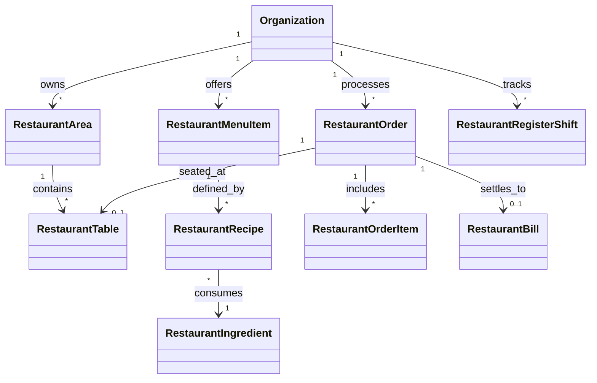
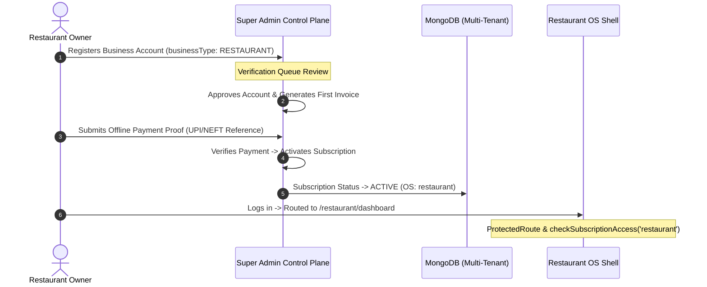

# ApexBuild Restaurant OS — Technical Architecture & System Design

> **Document Version:** 1.0.0  
> **Status:** Architecture Blueprint  
> **Target System:** ApexBuild Restaurant OS (Vertical 5)  
> **Ecosystem:** ApexBuild Multi-Tenant Control Plane  

---

## 1. Architectural Principles & Platform Conformance

ApexBuild Restaurant OS conforms strictly to the established ApexBuild Multi-Tenant Operating System architecture. Rather than introducing independent sub-frameworks, disparate styling libraries, or non-standard database access layers, Restaurant OS leverages:
1. **Centralized Super Admin Control Plane:** Commercial subscriptions, plan tiers, entitlement enforcement, and tenant provisioning remain managed exclusively by Super Admin.
2. **Unified Front-End Shell:** Standardized header, dynamic brand theming, responsive sidebar, bottom mobile bar, masquerading support, and PWA integration.
3. **Strict Tenant Scoping:** All MongoDB collections and database queries are strictly partitioned by `organizationId`.
4. **Decoupled Backend Boundaries:** Restaurant domain services operate in dedicated routers and controllers without contaminating Contractor, Supplier, Distributor, or Diagnostics modules.

---

## 2. Platform Component Reusability Matrix

The following existing platform assets are verified in the codebase and reused directly by Restaurant OS:

| Existing Platform Component / Service | Location | How Restaurant OS Leverages It |
| :--- | :--- | :--- |
| `ThemeContext` & `useBrandTheme()` | `frontend/src/context/ThemeContext.jsx` | Dynamic color injection, CSS custom properties (`--theme-primary`, `--theme-secondary`), white-label custom restaurant branding. |
| `OS_CONFIG` & `getOSConfig()` | `frontend/src/config/osThemes.js` | Centralized metadata, color schemes (warm culinary orange `#EA580C` & crimson `#DC2626`), shortCode `RT`, and route matching. |
| `SidebarUserProfile` | `frontend/src/components/layout/SidebarUserProfile.jsx` | Unified bottom profile card with plan badge, upgrade modal triggers, and logout confirmation. |
| `Header` | `frontend/src/components/layout/Header.jsx` | Unified header with search bar, notifications, tenant isolation status badge, and profile modal. |
| `LogoutConfirmationModal` | `frontend/src/components/common/LogoutConfirmationModal.jsx` | Standardized secure session termination dialog. |
| `PWAInstallBanner` & `OfflineStatusBanner` | `frontend/src/components/common/` | Touch-screen tablet and mobile installation prompts, connection loss indicator. |
| `MasqueradeBar` | `frontend/src/components/layout/MasqueradeBar.jsx` | Allows Super Admin to inspect a restaurant workspace without stealing session tokens. |
| `EntitlementContext` & `FeatureGate` | `frontend/src/context/EntitlementContext.jsx` | Gate advanced restaurant capabilities (e.g., KDS multi-station, recipe costing) based on plan tier. |
| `PlatformBilling` | `frontend/src/pages/PlatformBilling.jsx` | Reused for viewing OS subscriptions, invoices, and submitting offline UPI/bank payment receipts. |
| `api.js` (Axios Interceptors) | `frontend/src/services/api.js` | Universal JWT attachment, 401 unauthenticated redirect, and error propagation. |

---

## 3. Frontend Architecture & Routing Structure

### Route Map
```text
/restaurant
├── /dashboard              -> RestaurantDashboard.jsx (Daily operational KPIs, live tables, quick actions)
├── /pos                    -> RestaurantPOS.jsx (Touch POS layout, category menu grid, cart & settlement)
├── /kitchen                -> RestaurantKDS.jsx (Kitchen Display System with ticket timers & station filter)
├── /tables                 -> (Roadmap Phase 3: Area layouts, visual floor map, reservation bookings)
├── /menu                   -> (Roadmap Phase 4: Categories, items, modifiers, pricing & availability)
├── /recipes                -> (Roadmap Phase 5: Recipe BOMs, ingredient costing, auto stock deductions)
├── /inventory              -> (Roadmap Phase 6: Ingredients ledger, units of measure, wastage logs)
├── /purchases              -> (Roadmap Phase 7: Suppliers directory, POs, GRN acceptance)
├── /customers              -> (Roadmap Phase 8: Guest profiles, visit history, loyalty tags)
├── /shifts                 -> (Roadmap Phase 9: Cashier register shifts, cash float & drawer drops)
├── /expenses               -> (Roadmap Phase 10: Restaurant operating overheads & utility bills)
├── /reports                -> (Roadmap Phase 11: Food cost P&L, sales channels, tax audit summaries)
├── /settings               -> Settings.jsx (Restaurant profile, GSTIN, FSSAI, bill layout configuration)
├── /subscription           -> PlatformBilling.jsx (Restaurant OS subscription tier, invoices & payments)
└── /profile                -> Profile.jsx (User profile, password update)
```

### Layout Hierarchy
```text
<AuthProvider>
  <EntitlementProvider>
    <ThemeProvider>
      <ProtectedRoute allowedBusinessTypes={['RESTAURANT']}>
        <RestaurantLayout>
          ├── <Header />
          ├── Desktop Sidebar (64-width with culinary orange accents & navigation items)
          ├── Mobile Bottom Navigation (Quick POS, Kitchen, Tables, Dashboard & 'More' Drawer)
          ├── Floating Action Button (Quick New Order / Table Booking on mobile)
          └── <Outlet /> (Active Restaurant Screen)
        </RestaurantLayout>
      </ProtectedRoute>
    </ThemeProvider>
  </EntitlementProvider>
</AuthProvider>
```

---

## 4. Backend Service Boundaries & Data Models

### Mongoose Data Model Blueprint (Backend Phase Scope)


#### Core Data Entities:
1. **`RestaurantTable`**: `tableNumber`, `areaId`, `capacity`, `status` (`AVAILABLE`, `OCCUPIED`, `BILLED`, `CLEANING`, `RESERVED`), `activeOrderId`.
2. **`RestaurantMenuCategory`**: `name`, `displayOrder`, `stationId`, `isActive`.
3. **`RestaurantMenuItem`**: `name`, `shortCode`, `categoryId`, `price`, `dietaryType`, `variants` (size, price), `modifiers` (groups, add-ons), `kitchenStation`, `isAvailable`.
4. **`RestaurantIngredient`**: `name`, `purchaseUnit`, `consumptionUnit`, `conversionFactor`, `currentStock`, `reorderLevel`, `costPerUnit`.
5. **`RestaurantRecipe`**: `menuItemId`, `variantId`, `ingredients: [{ ingredientId, quantity, unit }]`, `estimatedCost`.
6. **`RestaurantOrder`**: `orderNumber`, `orderType` (`DINE_IN`, `TAKEAWAY`, `DELIVERY`), `tableId`, `stewardId`, `status` (`DRAFT`, `CONFIRMED`, `PREPARING`, `READY`, `SERVED`, `COMPLETED`, `CANCELLED`), `subTotal`, `discount`, `taxTotal`, `grandTotal`, `items: [...]`.
7. **`RestaurantBill`**: `billNumber`, `orderId`, `paymentStatus` (`PENDING`, `PAID`, `PARTIAL`, `VOID`), `paymentSplits: [{ method, amount, reference }]`, `taxBreakdown`, `invoiceDate`.
8. **`RestaurantShift`**: `cashierId`, `openedAt`, `closedAt`, `openingFloat`, `expectedCash`, `countedCash`, `variance`, `status`.

---

## 5. Super Admin Integration Architecture

To maintain platform cohesion, Restaurant OS integrates seamlessly with Super Admin:



### Feature Entitlement Definitions for Restaurant OS Plans:
- **`posBasic`**: Essential point of sale counter billing and receipt generation.
- **`dineInTables`**: Table layout management and visual floor map.
- **`kitchenDisplay`**: Real-time multi-station Kitchen Display System (KDS).
- **`recipeCosting`**: Detailed Bill of Materials (BOM) recipe costing and food cost margin analysis.
- **`inventoryLedger`**: Automatic ingredient stock deduction and supplier purchase management.
- **`cashierShifts`**: Cash drawer register management and blind drops.
- **`multiStationKDS`**: Routing orders independently across 3+ preparation stations.
- **`whiteLabelReceipts`**: Custom branding, logos, and custom tax headers on guest receipts.

---

## 6. Security, Isolation & Safety Controls

1. **Authentication & Token Payload:** JWT standard carries `id` and `organizationId`. Every query is forced to match `req.user.organizationId`.
2. **Access Redirection:** If a user with `businessType: 'CONTRACTOR'` attempts to navigate to `/restaurant/dashboard`, `ProtectedRoute` intercepts and redirects them back to `/dashboard`.
3. **No Cross-Pollination:** Restaurant OS routes and components never import or mutate Contractor, Supplier, Distributor, or Diagnostics controllers or models.
